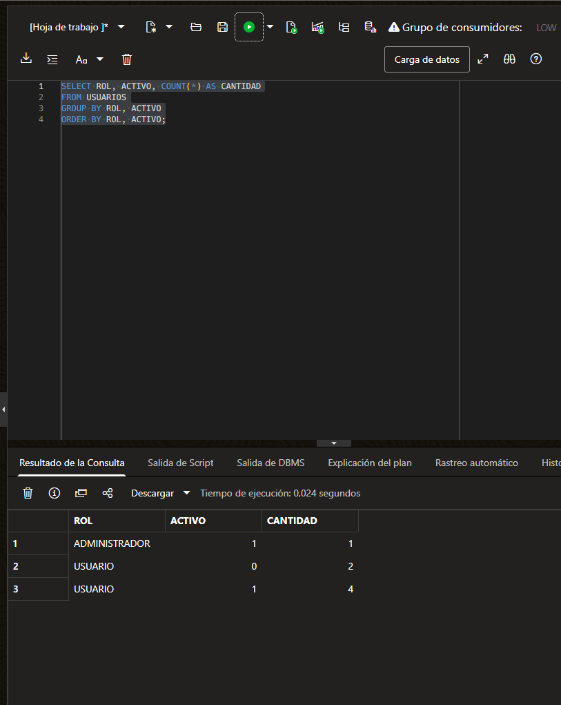

# Conteos Oracle de usuarios, antes de reiniciar

Fecha: 31 de octubre de 2026. Fuente: consulta SQL y captura aportadas por el usuario, después de los recorridos Postman aprobados.

Resultado observado: 7 cuentas: 1 ADMINISTRADOR activo, 4 USUARIO activos y 2 USUARIO inactivos. Total activo: 5. Las bajas lógicas conservan sus filas.

Esta captura acredita registros consultados en Oracle antes de detener los servidores. Sirve como referencia para comparar después de reiniciar las mismas aplicaciones con perfil oracle; todavía no acredita la comprobación de reinicio ni la integridad completa de relaciones o los bloqueos concurrentes.

