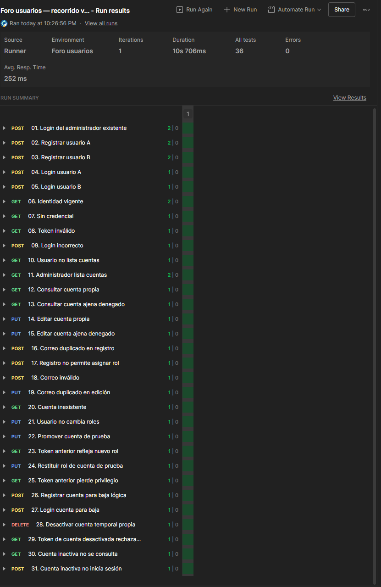

# Ejecución real de Postman: usuarios

Fecha: 31 de octubre de 2026. Fuente: captura del Runner aportada por el usuario durante la conexión guiada a Oracle.

- Colección: Foro usuarios — recorrido verificable.
- Entorno: Foro usuarios. Una iteración.
- 31 solicitudes completadas; 36 aserciones aprobadas; cero fallos visibles y cero errores.
- Duración: 10 s 706 ms.
- Las aplicaciones se iniciaron con perfil oracle según comandos y logs aportados previamente por el usuario. La cuenta administradora fue consultada en la tabla Oracle USUARIOS.
- La captura acredita la ejecución del Runner y sus resultados; no contiene contraseñas o tokens.
- Pendientes: verificar filas finales por SQL, persistencia tras reiniciar y concurrencia/bloqueos en Oracle. No se marca completo el bloque Oracle por esta sola ejecución.

